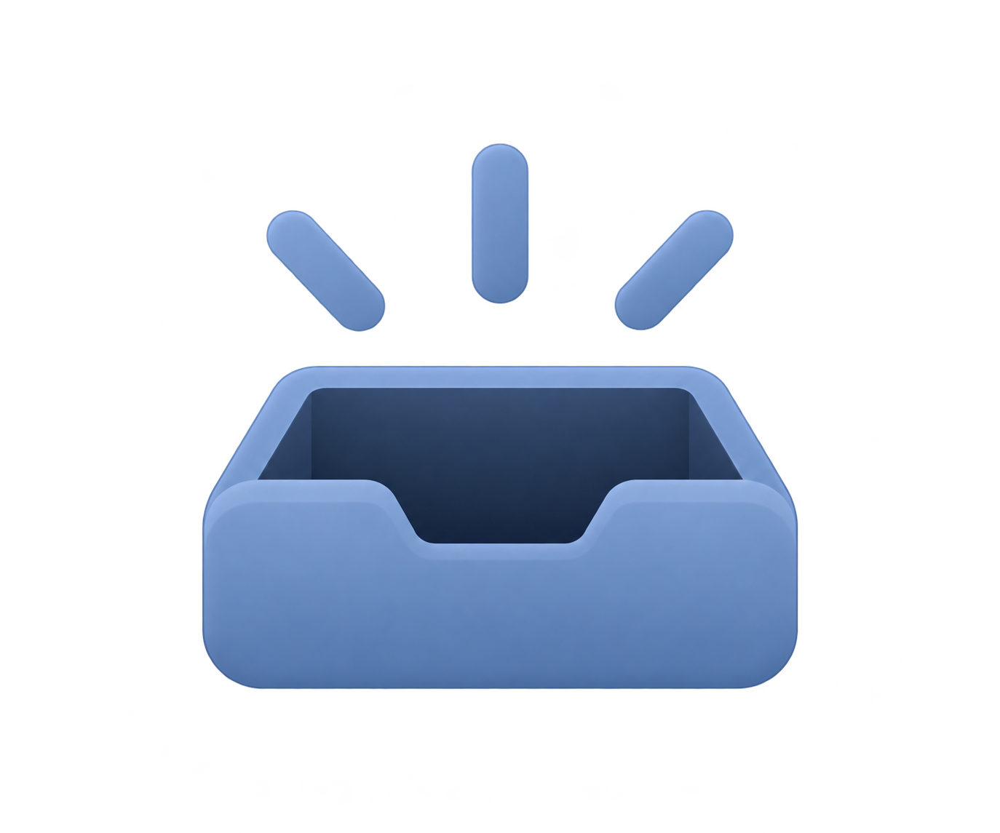

# Отдельные иллюстрации Gapchi AI

Пользователь одобрил остальные экраны и попросил сохранить центральные картинки отдельными файлами для использования в приложении. Они воссозданы встроенным imagegen по соответствующим макетам. Это PNG с настоящим прозрачным альфа-каналом, без подписей, карточек и окружающего интерфейса.

## Файлы и назначение

| Файл в проекте | URL в приложении | Где использовать |
| --- | --- | --- |
| `public/illustrations/gapchi-ai/empty-leads.png` | `/illustrations/gapchi-ai/empty-leads.png` | Пустой список лидов — планшет с силуэтом клиента |
| `public/illustrations/gapchi-ai/empty-conversations.png` | `/illustrations/gapchi-ai/empty-conversations.png` | Основная пустая панель диалогов — две реплики |
| `public/illustrations/gapchi-ai/onboarding-conversations.png` | `/illustrations/gapchi-ai/onboarding-conversations.png` | Баннер первого запуска в обзоре — окно и реплики |
| `public/illustrations/gapchi-ai/empty-inbox.png` | `/illustrations/gapchi-ai/empty-inbox.png` | Последние обращения и пустой список диалогов — входящий лоток |

## Предпросмотр

### Лиды

### Диалоги

### Первый запуск

### Входящие

## Инструкция для Antigravity

- Используй существующие файлы по приведённым URL; повторная генерация или извлечение из скриншота не нужны.
- Сохраняй исходные пропорции и прозрачность, размещай через существующий подход проекта к изображениям с `object-fit: contain`.
- Ориентир визуального размера: лиды 140–200 px, диалоги 200–280 px, баннер запуска 260–360 px, входящие 64–112 px. Учитывай прозрачные поля внутри PNG и уменьшай изображения на мобильном.
- Не растягивай иллюстрации на весь экран. Они сопровождают текст и действия, а не заменяют их.
- Считай изображения декоративными: пустой alt, смысл и действие должны оставаться в обычном тексте интерфейса.
- Проверь обе темы и отсутствие тёмного или белого прямоугольника вокруг объекта. Цвета самих объектов сохраняй.
- Навигационные иконки, кнопки и логотипы каналов продолжают использовать Lucide и существующие брендовые ассеты: эти иллюстрации их не заменяют.
- Центральная иллюстрация в макете интеграций — предпросмотр самого виджета. Его нужно собирать из UI и фактических настроек, а не вставлять скриншотом.

[Промпты создания](ILLUSTRATION-PROMPTS.md). Прозрачность проверена чтением RGBA и альфа-канала всех четырёх файлов; код приложения в этой передаче не менялся.
