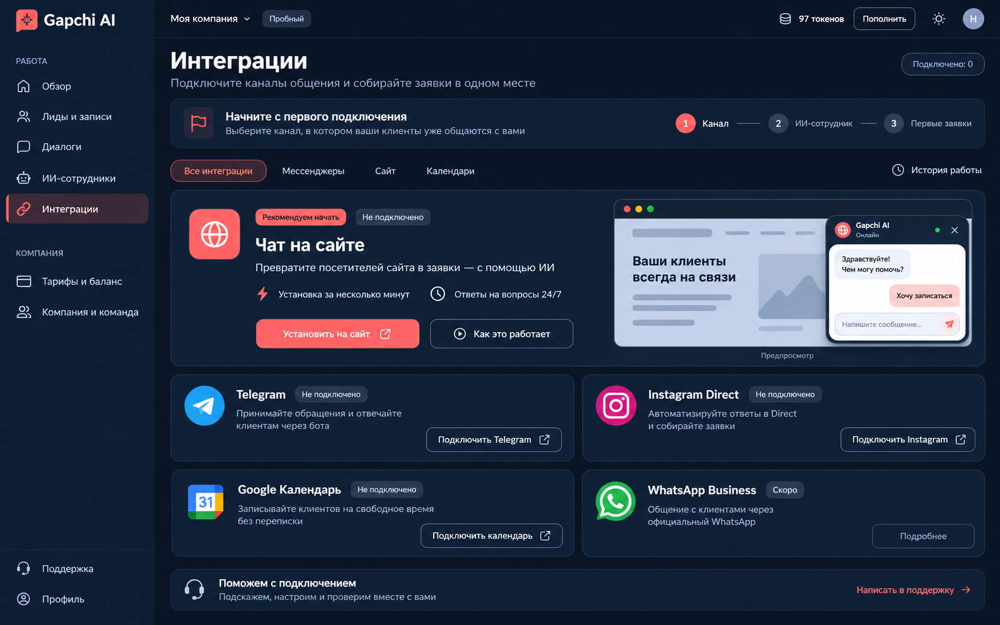

# Gapchi AI — макет интеграций для Antigravity

Пользователь одобрил визуальное направление этого макета и попросил передать его Antigravity через общую папку проекта. Это дизайн-референс; реализация интерфейса в рамках этой передачи не изменялась.

## Файлы

- [Макет рабочего стола, PNG 1586 × 992](mockup-desktop.png).
- [Иконки: источники, размеры и соответствие элементам](ICONS.md).

Изображение создано инструментом imagegen как концепт интерфейса. Надписи и числовые значения в нём иллюстративные: баланс, компания и статусы в приложении должны поступать из действующего состояния сервиса.

## Задача для Antigravity

Прочитай этот документ, открой PNG и изучи ICONS.md. Реализуй страницу интеграций Gapchi AI в показанном стиле, используя существующие компоненты и обработчики подключений. Сначала прочитай корневой AGENTS.md и релевантные руководства установленного Next.js.

Сохрани текущую работу над переименованием и подтверждением входа кодом. Не откатывай чужие изменения. Название продукта — **Gapchi AI**.

Ориентиры в коде:

- `app/dashboard/integrations/page.tsx` — страница и действующие подключения.
- `components/integrations/WebsiteWidgetIntegration.tsx` — настройка виджета.
- `components/integrations/ChannelEventLog.tsx` — история событий.
- `components/layout/Sidebar.tsx` и `components/layout/Header.tsx` — общая оболочка.
- `components/ui/` — существующие элементы интерфейса.

Общие изменения оболочки должны сохранять работу остальных страниц кабинета.

## Композиция

1. Слева — навигация, сверху — компактная панель компании и баланса.
2. Заголовок «Интеграции», описание и нейтральный счётчик подключений. Зелёный цвет означает реальную активность, а не доступность функции.
3. При отсутствии подключений — блок «Начните с первого подключения» с последовательностью «Канал → ИИ-сотрудник → Первые заявки». После подключения показывай полезное текущее состояние вместо предложения начать заново. Шаги должны соответствовать реальным действиям продукта.
4. Фильтры «Все интеграции», «Мессенджеры», «Сайт», «Календари». «История работы» — отдельное действие для существующего журнала.
5. Широкая главная карточка «Чат на сайте»: польза, действие «Установить на сайт», справа — демонстрационный предпросмотр чата с подписью «Предпросмотр». Для «Как это работает» используй реальную справку или существующую настройку, без неработающей кнопки.
6. Telegram, Instagram Direct, Google Календарь и WhatsApp Business — одинаковые компактные карточки в сетке 2 × 2. Основные действия этих карточек — сдержанные кнопки с обводкой.
7. Внизу — строка помощи с переходом к действующей поддержке.

Состояния каналов: «Подключено», «Не подключено», «Требует внимания», «Скоро». Подключённые карточки должны показывать реальные сведения и действия управления. Недоступные подключения не выдавай за работающие.

## Визуальная система

| Элемент | Ориентир |
| --- | --- |
| Фон страницы | `#0B1220` |
| Навигация | `#101B2E` |
| Карточки | `#142137` |
| Границы | `#29374C` |
| Основной акцент | `#FF7277` |
| Основной текст | `#F4F7FB` |
| Вторичный текст | `#AABAD0` |
| Скругления | 12–16 px |
| Сетка отступов | Кратная 8 px; обычные промежутки 16–24 px |
| Шрифт | Нейтральный sans-serif с полноценной кириллицей; сначала используй действующий шрифт проекта |

Акцент концентрируется на установке чата и выбранной навигации. Сохрани спокойные тёмно-синие поверхности, тонкие границы, ясную иерархию и читабельные описания. Не добавляй объёмные 3D-эффекты или сильное свечение.

На коралловой основной кнопке используй тёмный текст либо другой проверенный по контрасту вариант: белый текст из растрового концепта не является обязательным требованием. Проверяй контраст обычного текста не ниже 4.5:1, состояния фокуса и элементы управления — по применимым требованиям WCAG AA. Сохрани видимый клавиатурный фокус и достаточную область нажатия.

Макет задаёт тёмную тему. Светлая тема должна сохранять ту же композицию с соответствующими светлыми поверхностями и контрастом. На телефоне карточки идут в одну колонку; предпросмотр виджета переносится под описание или упрощается. Горизонтального прокручивания страницы быть не должно.

Логотип-значок в концепте иллюстративный. Используй актуальный логотип Gapchi AI из задачи ребрендинга; при его отсутствии — аккуратный текстовый wordmark. Не вырезай логотип или иконки из PNG.

## Функциональность и проверка

- Сохрани проверки прав, подключения, настройки сотрудников, расписание, установочный код виджета и журнал событий.
- Макет не является подтверждением готовности Instagram, WhatsApp или других внешних сервисов.
- Адрес сайта, OAuth callback, cookies, ключи и схема рабочей БД не относятся к визуальному переоформлению.
- Проверь 375, 768 и 1440 px, обе темы, переключение фильтров, все состояния карточек, клавиатурную навигацию и существующие диалоги подключения.
- Запусти подходящие существующие проверки типов, сборку и проверку изменённых файлов. Новые тесты добавляй только для изменённого поведения.
- Покажи Preview и снимки основных состояний. Рабочую БД и основной сайт автоматически не обновляй.

В итоговом отчёте укажи выбранные иконки и объясни существенные отклонения от макета. Пока согласование выполнено через эти файлы: прямого обмена сообщениями между Codex и Antigravity не было.
